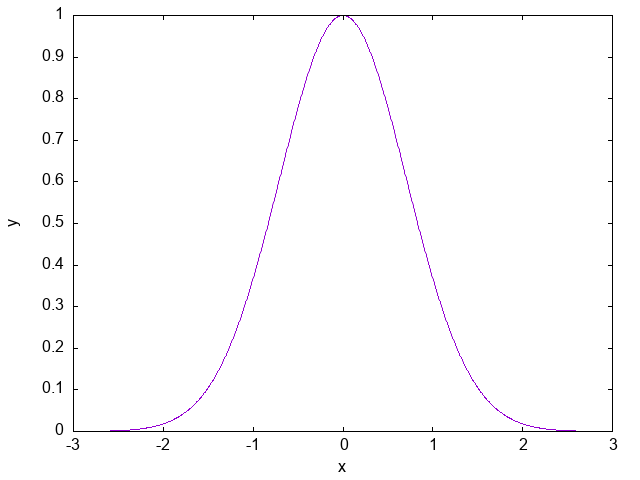
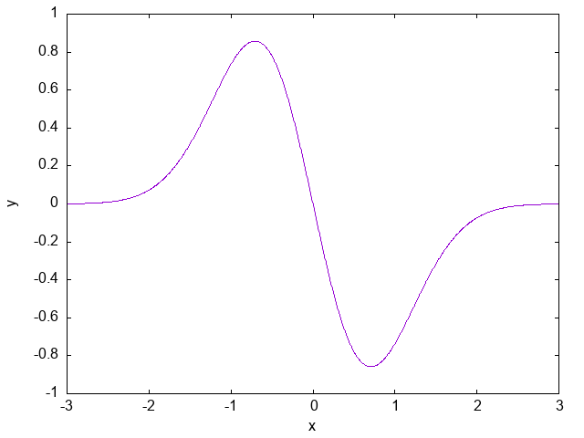
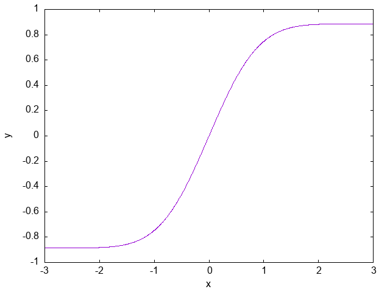

# 函数式编程中的数值微积分

用 Haskell 的高阶函数进行数值微积分。

核心计算使用 `Double`，仅依赖 `base`；可选的绘图模块使用 Gnuplot。

## 快速开始

安装 GHC 后，在项目根目录运行

```sh
runghc Main.hs gaussian
```

终端的输出为

```txt
gaussian on [-3.00, 3.00]
+---------+------------+-------------+---------------+
|       x |       f(x) |       f'(x) | integral(a,x) |
+---------+------------+-------------+---------------+
| -3.0000 | 0.00012341 |  0.00074046 |    0.00000000 |
| -1.5000 | 0.10539922 |  0.31619767 |    0.03001895 |
|  0.0000 | 1.00000000 |  0.00000000 |    0.88620735 |
|  1.5000 | 0.10539922 | -0.31619767 |    1.74239574 |
|  3.0000 | 0.00012341 | -0.00074046 |    1.77241470 |
+---------+------------+-------------+---------------+
Integral over interval: 1.7724146965
```

不传参数会展示所有示例。每个示例在指定区间输出五个采样点的函数值、导数和从区间左端开始的定积分

```sh
runghc Main.hs
```

`Main.hs` 的其余参数有：

- `--help` 显示用法

  ```sh
  runghc Main.hs --help
  ```

- `--list` 列出所有函数

  ```sh
  runghc Main.hs --list
  ```

### 用 Cabal 运行

用 `cabal` 运行和用 `runghc` 的方式类似，只不过需要在 `--` 后添加参数

```sh
cabal build
cabal run numerical-calculus -- --help
cabal run numerical-calculus -- gaussian
```

### 用 GHCi 探索

首先启动 GHCi 会话

```sh
ghci
```

然后加载模块

```haskell
:load Derivative.hs Integrate.hs Functions.hs
:module + Derivative Integrate Functions
```

接着自定义函数，并用模块提供的接口计算数值微积分

```haskell
f x = sin x + x * x
fD = derivative f
fI = integralFromLower 0 f
fD 1    -- 2.540302305953368
fI 1    -- 0.7930310268234009
```

也可以直接使用预定义的函数

```haskell
derivative gaussian 1       -- -0.7357588823475592
integrate 0 pi sin          -- 2.0000000082246694
integrate 1 0 id            -- -0.5000000000000001
integralIndefinite id 3 2   -- 5.0
```

还可以在数值上验证微积分基本定理。当然，由于是数值微积分，所以存在一些误差

```haskell
derivative (integralFromLower 0 gaussian) 0.5
-- 0.778800784251299
gaussian 0.5
-- 0.7788007830714049
```

提供的数值算法接口见 [#数值算法接口](#数值算法接口)，提供的预定义函数见 [#预定义函数](#预定义函数)。

### 用 Gnuplot 绘图

绘图功能要求 `PATH` 中存在可用的 `gnuplot` 程序。`gnuplot` 程序的安装请参考 <http://www.gnuplot.info/download.html>。

安装完成后，在项目根目录运行以下命令

```sh
cabal repl lib:numerical-calculus-in-fp -fplotting
```

该命令会构建所需的 Haskell `gnuplot` 包，并打开已载入绘图模块的 GHCi 会话。

然后在 GHCi 会话中导入模块

```haskell
:module + Plot Derivative Integrate Functions
```

最后绘制函数并保存为 PNG 图片

```haskell
plotFunction "images/gaussian.png" (-3) 3 gaussian
plotFunction "images/gaussian-derivative.png" (-3) 3 (derivative gaussian)
plotFunction "images/gaussian-integral.png" (-3) 3 (integralFromLower 0 gaussian)
```

保存的图片为

| gaussian                         | gaussian-derivative                                    | gaussian-integral                                  |
| -------------------------------- | ------------------------------------------------------ | -------------------------------------------------- |
|  |  |  |

`plotFunction path xmin xmax f` 的参数分别为

- `path`：要保存的 PNG 文件路径，相对于当前目录。如果保存在子目录中，则需要先创建子目录，否则会保存失败
- `xmin`：绘制区间的左端点
- `xmax`：绘制区间的右端点
- `f`：要绘制的函数

## 预定义函数

预定义函数写在 [Functions.hs](Functions.hs) 中。

提供的预定义函数有：

- `cubic x`：三次多项式
  $$
  f(x)=x^3-x
  $$
- `gaussian x`：高斯函数
  $$
  f(x)=e^{-x^2}
  $$
- `sinc x`：原点处连续延拓的 sinc 函数
  $$
  f(x)=
  \begin{cases}
    1 & x=0 \\
    \dfrac{\sin x}{x} & x\ne 0
  \end{cases}
  $$
- `logistic x`：logistic 函数
  $$
  f(x)=\frac{1}{1+e^{-x}}
  $$
- `dampedSine x`：高斯包络下的正弦振荡
  $$
  f(x)=e^{-x^2}\sin(5x)
  $$
- `runge x`：runge 函数
  $$
  f(x)=\frac{1}{1+25x^2}
  $$
- `oscillatory x`：原点可导但导数在原点不连续的振荡函数
  $$
  f(x)=
  \begin{cases}
    0 & x=0 \\
    x^2\sin(\frac{1}{x}) & x\ne 0
  \end{cases}
  $$

## 数值算法接口

数值微分算法写在 [Derivative.hs](Derivative.hs) 中，数值积分算法写在 [Integrate.hs](Integrate.hs) 中。

提供的数值算法接口有：

- `derivative f x`: $f$ 在 $x$ 处的数值导数
  $$
  f'(x)
  $$
- `derivativeWithStep h f x`: 步长为 $h$ 的中心差分
  $$
  \frac{f(x+h)-f(x-h)}{2h}
  $$
- `integrate a b f`: 从 $a$ 到 $b$ 的定积分
  $$
  \int_a^b f(x) \mathrm{d}x
  $$
- `integrateWithSteps n a b f`: $n$ 个等长子区间的中点黎曼和
  $$
  \frac{b-a}{n}
  \sum_{i=0}^{n-1}
  f\left(a+\left(i+\frac12\right)\frac{b-a}{n}\right)
  $$
- `integralFromLower a f x`: 从固定下限 $a$ 到变上限 $x$ 的积分
  $$
  \int_a^x f(t) \mathrm{d}t
  $$
- `integralToUpper b f x`: 从变下限 $x$ 到固定上限 $b$ 的积分
  $$
  \int_x^b f(t) \mathrm{d}t
  $$
- `integralIndefinite f c x`: 从固定下限 $0$ 到变上限 $x$ 的积分再加上常数 $c$
  $$
  \int_0^x f(t) \mathrm{d}t + c
  $$
- `integralDefinite a b f`: `integrate a b f` 的别名
